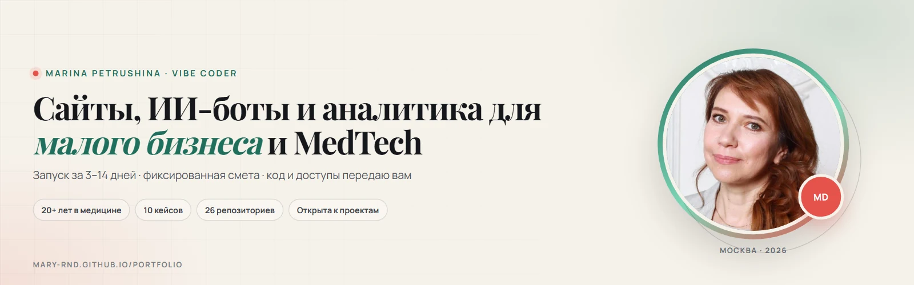
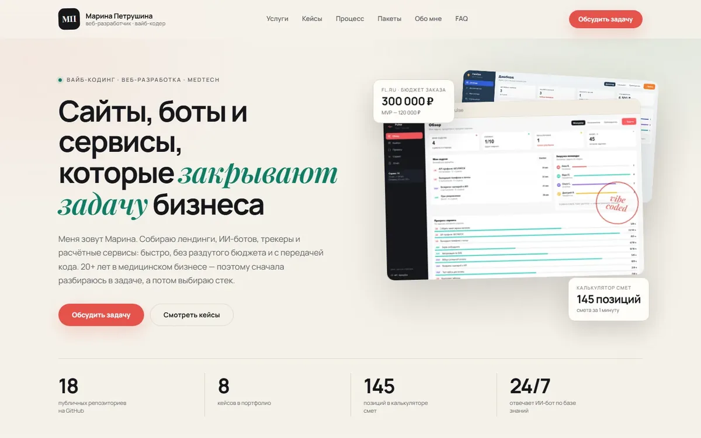
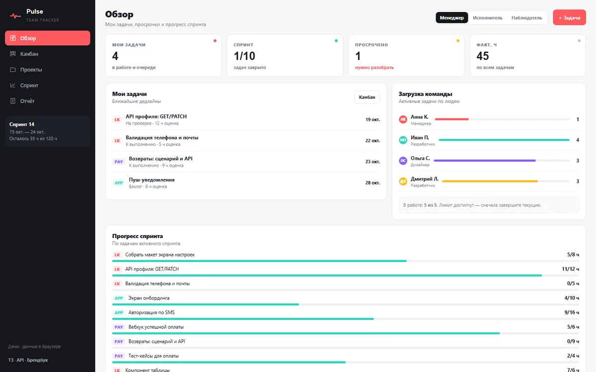
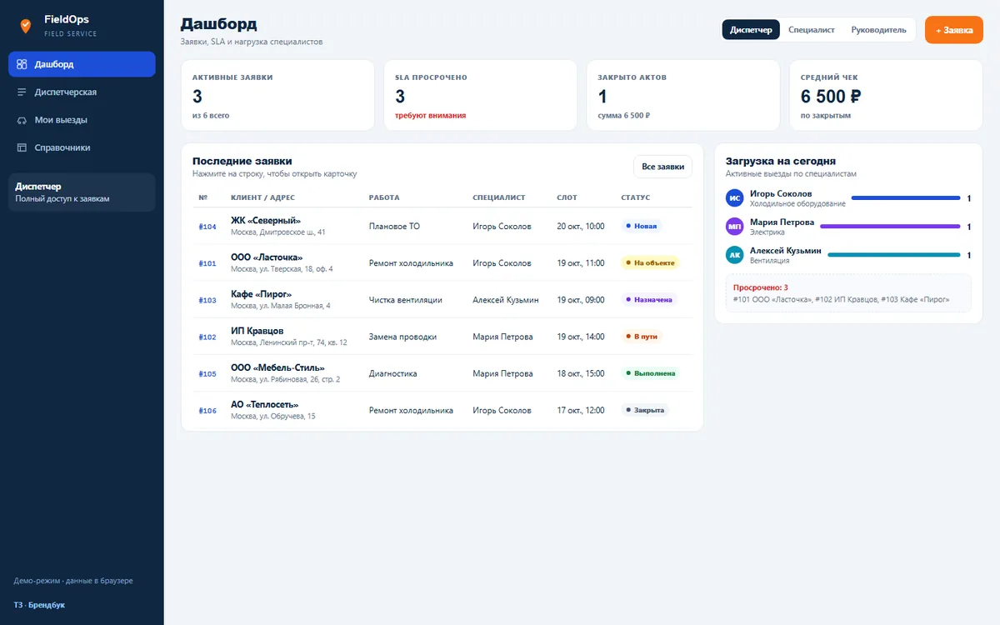
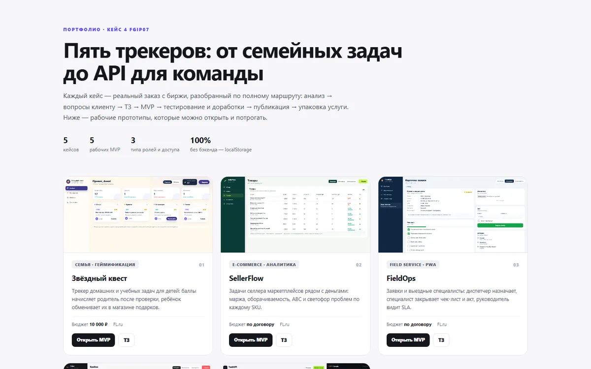
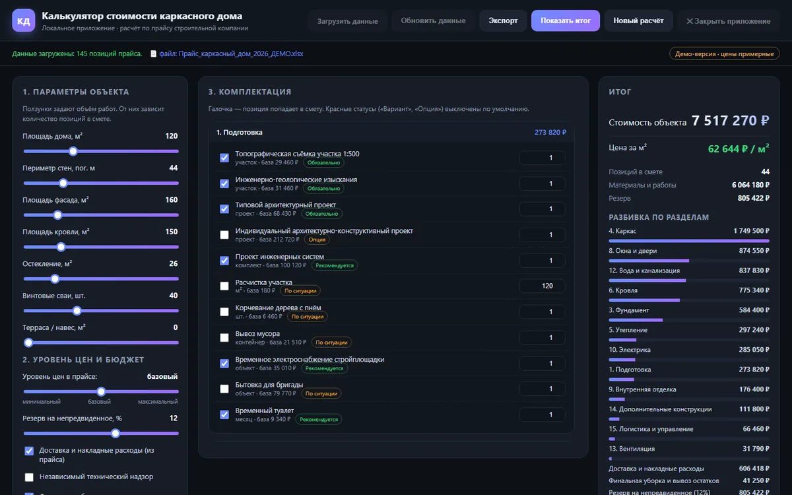
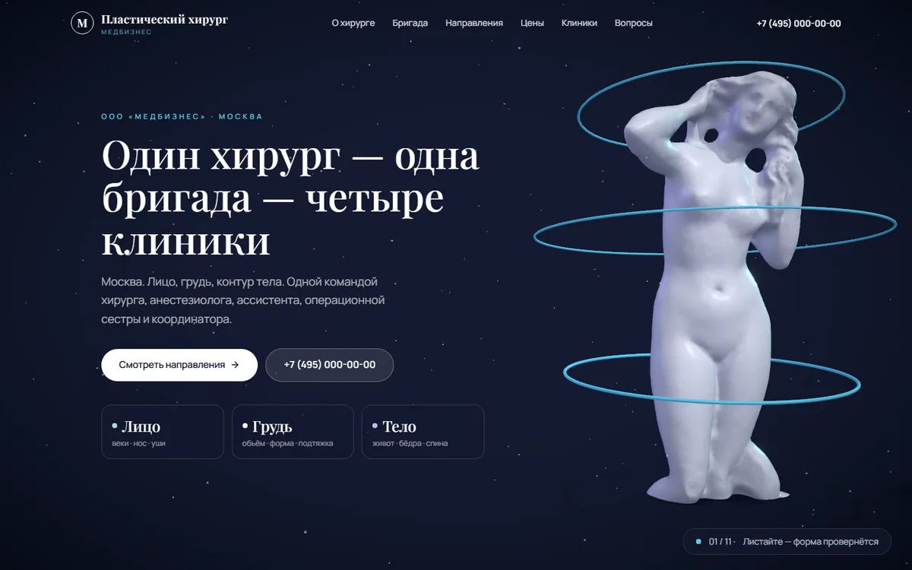

# Марина Петрушина

**Вайб-кодер и веб-разработчик.** Делаю сайты, ИИ-ботов, трекеры, дашборды и аналитику для малого бизнеса и MedTech.

> «Сначала — задача и ответственность. Потом — код».
>
> 20+ лет в медицинском бизнесе и 10+ лет клинической практики. Понимаю, где данные, деньги и ответственность, — и собираю продукты, которые решают задачу, а не просто красиво выглядят.

**Стек:** HTML/CSS/JS · React · Next.js · TypeScript · Three.js / React Three Fiber · Tailwind CSS · Python · pandas · SQLite · PWA · GitHub Pages.

**ИИ:** GigaChat · OpenAI · Qwen · DeepSeek · Claude · Gemini · Ollama · RAG и базы знаний · боты Telegram и VK.

---

## Что я делаю

| Направление | Что получаете | Срок | От |
| --- | --- | --- | --- |
| **Лендинги и сайты** | Оффер, структура, адаптив, формы, SEO-база, публикация | 3–5 дней | 15 000 ₽ |
| **ИИ-боты по базе знаний** | Бот для VK или Telegram: сценарии, база знаний, fallback, передача | 5–7 дней | 15 000 ₽ |
| **Трекеры и внутренние системы** | Kanban, заявки, роли, отчёты, учёт часов, PWA | 7–14 дней | 25 000 ₽ |
| **Калькуляторы и автоматизация** | Расчёты, обезличивание Excel/Word, отчёты, интеграции | 3–7 дней | 25 000 ₽ |
| **Дашборды и аналитика** | Сводные таблицы, фильтры, графики, сравнение закупок | 2–5 дней | 50 000 ₽ |
| **Поддержка** | Хостинг, домен, бэкапы, правки, мониторинг, отчёт | помесячно | от 3 000 ₽/мес. |

---

## Избранные кейсы

<table>
<tr>
<td width="50%" valign="top">

**Портфолио — этот сайт** 
10 кейсов, фильтры, модалки, пакеты и форма заявки. Editorial-дизайн, HTML/CSS/JS, GitHub Pages. 
<a href="https://mary-rnd.github.io/portfolio/">Открыть</a> · <a href="https://github.com/Mary-RND/portfolio">Код</a>

</td>
<td width="50%" valign="top">

**Pulse — трекер задач** 
Kanban с WIP-лимитом 5, спринты, burndown, учёт часов, 4 роли. HTML/CSS/JS, localStorage. 
<a href="https://mary-rnd.github.io/pulse/">Демо</a> · <a href="https://github.com/Mary-RND/pulse">Код</a>

</td>
</tr>
<tr>
<td width="50%" valign="top">

**FieldOps — заявки и выезды** 
PWA для диспетчеров и выездных специалистов: 4 роли, SLA-таймеры, чек-листы, акты, фото. 
<a href="https://mary-rnd.github.io/fieldops/">Демо</a> · <a href="https://github.com/Mary-RND/fieldops">Код</a>

</td>
<td width="50%" valign="top">

**Tracker Cases — 5 сценариев** 
Канбан, CRM, заявки, контент-план и найм: демо-трекеры для малого бизнеса. 
<a href="https://mary-rnd.github.io/tracker-cases/">Демо</a> · <a href="https://github.com/Mary-RND/tracker-cases">Код</a>

</td>
</tr>
<tr>
<td width="50%" valign="top">

**Калькулятор каркасного дома** 
145 позиций прайса, 16 разделов, цена за м² и смета за минуту. Python + HTML/CSS/JS. 
<a href="https://mary-rnd.github.io/karkas-dom-calculator/">Демо</a> · <a href="https://github.com/Mary-RND/karkas-dom-calculator">Код</a>

</td>
<td width="50%" valign="top">

**Пластическая хирургия — 3D-лендинг** 
React Three Fiber, запись на консультацию, SEO и адаптив. Кейс медицинской клиники. 
<a href="https://mary-rnd.github.io/plastic-surgery-landing/">Демо</a> · <a href="https://github.com/Mary-RND/plastic-surgery-landing">Код</a>

</td>
</tr>
</table>

---

## Медицина и аналитика

Отдельное направление: клиники, медизделия, данные и закупки.

- **[MedTech-лендинг](https://mary-rnd.github.io/medtech-landing/)** — сайты практик, ИИ-боты записи, дашборды закупок и обезличивание данных. Медицинская палитра, 152-ФЗ. [Код](https://github.com/Mary-RND/medtech-landing)
- **[Сайт пластического хирурга](https://mary-rnd.github.io/plastic-surgery-landing/)** — Next.js, React Three Fiber, 3D-герой и прайс.
- **[Дашборд закупок MedTech](https://mary-rnd.github.io/procurement-demo/)** — сравнение предложений поставщиков и сводка по закупкам.
- **[Рынок инфузионных насосов](https://mary-rnd.github.io/infusion-pumps-dashboard/)** — 200 сделок, 108 больниц, 59 регионов: лидеры, цены и спрос.
- **[Обезличиватель данных](https://github.com/Mary-RND/data-depersonalizer)** — Excel/Word, офлайн, обратная конвертация по ключу.

**Фокус:** 152-ФЗ, клинические процессы, аналитика закупок и KPI.

---

## Ещё кейсы

- [MedTech-лендинг](https://mary-rnd.github.io/medtech-landing/) — отдельная посадочная для клиник: сайты, боты, дашборды и работа с данными. [Код](https://github.com/Mary-RND/medtech-landing)
- [Task Dispatcher — командный центр входящих задач](https://mary-rnd.github.io/task-dispatcher/) — KPI, фокус дня, нагрузка команды, поиск дублей и сводка для планёрки. [Код](https://github.com/Mary-RND/task-dispatcher)
- [EventFlow — участники мероприятия](https://mary-rnd.github.io/eventflow/) — CRUD, поиск и фильтры, импорт CSV с предпросмотром ошибок, бэкапы JSON. [Код](https://github.com/Mary-RND/eventflow)
- [Route Planner — планировщик путешествий](https://mary-rnd.github.io/route-planner/) — маршрут по дням, бюджет, бронирования и чек-лист, офлайн. [Код](https://github.com/Mary-RND/route-planner)
- [Лендинг вебинара по ИИ-аналитике](https://mary-rnd.github.io/vebinar-ii-analitik-landing/) — форма регистрации, таймер, Open Graph. [Код](https://github.com/Mary-RND/vebinar-ii-analitik-landing)
- [Дашборд закупок MedTech](https://mary-rnd.github.io/procurement-demo/) — сравнение предложений поставщиков и сводка. [Код](https://github.com/Mary-RND/procurement-demo)
- [Аналитика рынка инфузионных насосов](https://mary-rnd.github.io/infusion-pumps-dashboard/) — конкуренты, цены, закупки, 2025–2026. [Код](https://github.com/Mary-RND/infusion-pumps-dashboard)
- [ИИ-бот для VK](https://github.com/Mary-RND/vk-ai-assistant) — GigaChat API, 20 сообщений контекста, fallback на менеджера.
- [Обезличиватель данных](https://github.com/Mary-RND/data-depersonalizer) — Excel/Word, обратная конвертация по ключу, 152-ФЗ.
- [SportLand v2](https://mary-rnd.github.io/sport-land-v2-landing/) — лендинг вебинара «5 привычек»: прогрев, программа, кейсы до/после, форма записи. [Код](https://github.com/Mary-RND/sport-land-v2-landing)

[Все публичные проекты →](https://github.com/Mary-RND?tab=repositories) · 26 репозиториев, 20 публичных.

---

## Как проходит работа

1. **Бриф, 20 минут.** Задача, пользователи, ограничения, сроки. Без брифа не берусь — чтобы не угадывать.
2. **Структура и смета.** Разбиваю задачу на блоки, фиксирую объём, цену и критерии готовности.
3. **Прототип.** Согласуем первый экран и логику до кода. Правки на этом этапе — бесплатно.
4. **Сборка.** Адаптив, формы, интеграции, проверка в браузере, базовая оптимизация.
5. **Запуск и передача.** Публикация, доступы, инструкция, 30 дней гарантии на исправление ошибок.

**Оплата:** 50% в начале, 50% после сдачи. Первый круг правок включён, второй и последующие — 1 500 ₽/час.

---

## Почему MedTech

- **20+ лет в медицинском бизнесе** и **10+ лет клинической практики**, MD.
- Основатель и руководитель R&D-центра **AI Predictive Medicine Lab**.
- Понимаю **152-ФЗ**, обезличивание данных, клинические и закупочные процессы.
- Делаю не «сайт про медицину», а инструменты для реальных процессов: заявки, записи, закупки, аналитика, отчётность.
- **Аналитика:** дашборды закупок, рынка и KPI — на данных, а не на ощущениях.

---

## Пакеты

| Пакет | Что входит | Цена |
| --- | --- | --- |
| **База** | Бриф, ТЗ, прототип, разработка, адаптив, SEO-база, первый круг правок, публикация, код и доступы, 30 дней гарантии | от 25 000 ₽ |
| **База+** | Всё из «Базы» + хостинг, домен и бэкапы, до 2 часов правок в месяц, мониторинг, приоритетный ответ, отчёт раз в месяц | от 25 000 ₽ + от 3 000 ₽/мес. |

---

## Контакты

- **Портфолио:** [mary-rnd.github.io/portfolio](https://mary-rnd.github.io/portfolio/)
- **MedTech-лендинг:** [mary-rnd.github.io/medtech-landing](https://mary-rnd.github.io/medtech-landing/)
- **Telegram:** [@marypetrova6](https://t.me/marypetrova6)
- **VK:** [@marina_petrushina](https://vk.com/marina_petrushina)
- **WhatsApp:** [+7 985 728-66-55](https://wa.me/79857286655)
- **Email:** [mar.petrushina@yandex.ru](mailto:mar.petrushina@yandex.ru)
- **GitHub:** [@Mary-RND](https://github.com/Mary-RND)
- **География:** Москва, работаю удалённо; беру проекты по всей России.

### Есть задача?

Напишите в [Telegram](https://t.me/marypetrova6), [VK](https://vk.com/marina_petrushina), WhatsApp или на почту. Отвечу в течение дня, задам 3–5 вопросов и предложу вилку по срокам и цене. Без обязательств и «менеджерского» тона.

Open to freelance projects: landing pages, AI assistants, task trackers, data automation. Remote, worldwide.

Сайт и код — мои. AI — инструмент, ответственность за результат — на мне. © 2026 Марина Петрушина
